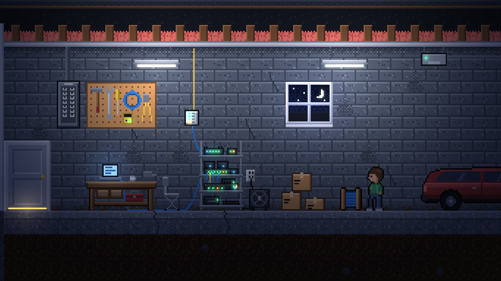
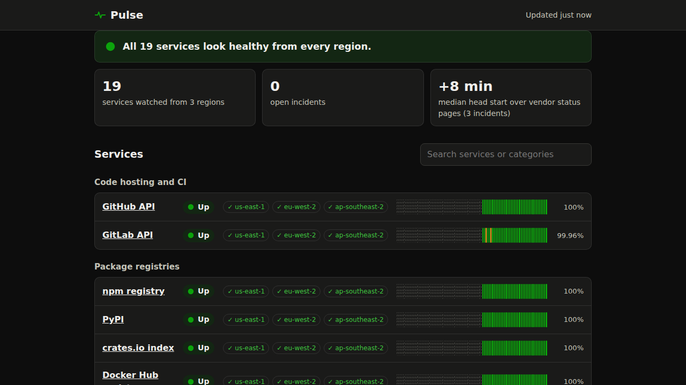
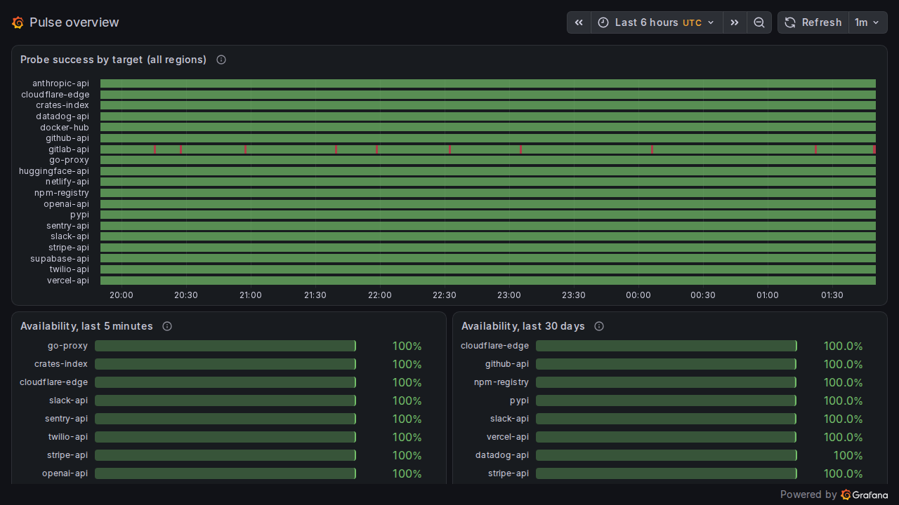
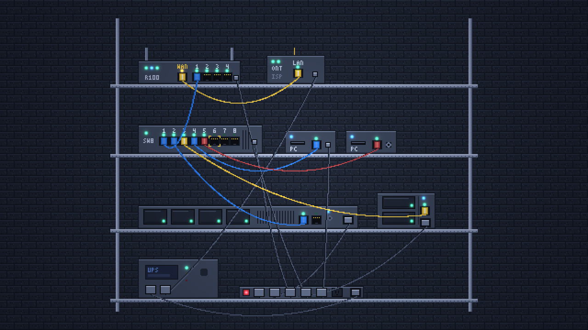

<table>
<tr>
<td>

<b>Hey, I'm Leo. Nice to meet you 👋</b>
</td>
</tr>
<tr>
<td>

</td>
</tr>
<tr>
<td>
<b>building</b> 
<a href="https://status.leotem.dev"><b>Pulse</b></a>: a downdetector for developer tools. It probes 19 APIs every minute from 3 AWS regions and reports an outage only when the regions agree. <a href="https://leotem.dev/projects/pulse/">How it works</a> 
<a href="https://five-nines.pages.dev"><b>Five Nines</b></a>: a 2D infrastructure tycoon game. You start with a homelab in a garage and grow it into a multi-region platform. Private playtest. 
<a href="https://github.com/leotemtem/RepoMonster"><b>RepoMonster</b></a>: a self-hosted review gate for GitHub and GitLab, with deterministic checks, RAG and an LLM. 
<a href="https://github.com/leotemtem/MoneyFlow"><b>MoneyFlow</b></a>: local-first personal finance analysis for students. 
<a href="https://github.com/TwiN/gatus/pull/1864"><b>Gatus</b></a>: open-source contributor, PR #1864 merged upstream.
</td>
</tr>
<tr>
<td>
<b>languages</b> 

</td>
</tr>
<tr>
<td>
<b>cloud / infra</b> 

</td>
</tr>
<tr>
<td>
<b>observability / sre</b> 

</td>
</tr>
<tr>
<td>
<b>data / ai</b> 

</td>
</tr>
<tr>
<td>
<b>web / games</b> 

</td>
</tr>
<tr>
<td>
<b>certifications</b> 

</td>
</tr>
</table>

BSc Computer Science, University of Kent · <a href="https://leotem.dev">leotem.dev</a>
